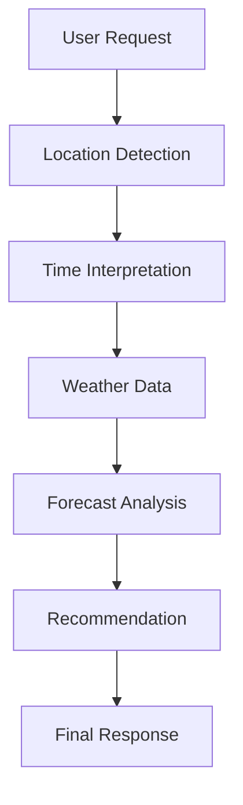

# 🌤️ Weather Forecast Agent

A small, reusable **Agent Skill** that answers weather questions in plain language. It is built entirely from Markdown: no Python, no servers, no dependencies.

## Overview

You ask a weather question in natural language ("Will it rain in Mumbai tomorrow evening?"). The agent works out *where* and *when* you mean, looks up live forecast data using whatever tool the host platform provides, interprets it, and replies with a short answer plus a practical tip.

The whole agent is defined by a single file, [`SKILL.md`](SKILL.md), which an AI agent (for example Claude) reads and follows.

## Why this agent?

It is intentionally small, but it shows the core ideas of agentic AI:

| Concept | How it appears here |
|---------|---------------------|
| **Agent Skills** | The behavior is packaged as a `SKILL.md` with a name, description, and instructions |
| **Natural language interpretation** | "tonight", "this weekend", "near me" are converted into concrete locations and time windows |
| **Tool / data retrieval** | The agent uses live weather data from the platform instead of guessing |
| **Decision making** | Chooses between a simple answer, a focused answer, or a multi-day table; asks a clarifying question only when needed |
| **Response generation** | Interprets the data and adds recommendations rather than dumping numbers |
| **Progressive disclosure** | `SKILL.md` stays short; detailed formatting lives in `references/` and is loaded only when needed |

## Architecture



## Features

- Understands city names and "near me" (when the environment supports location)
- Interprets today, tonight, this evening, tomorrow, this weekend, next 3/5/7 days
- Answers the question asked first, without extra clutter
- Interprets rain risk, heat, cold, wind, thunderstorms, and visibility
- Gives short, practical recommendations without exaggeration or medical advice
- Uses a consistent response format, including a compact multi-day table
- **Never fabricates weather data.** If live data is unavailable, it says so

## Example

**Input**

> Will it rain in Mumbai tomorrow evening?

**Output** *(illustrative values)*

```text
Yes, rain looks likely in Mumbai tomorrow evening.

The chance of rain rises to about 75% between 6 and 8 PM, with moderate showers expected and a possible rumble of thunder. It should ease after about 9 PM.

Recommendation: Carry an umbrella or raincoat, and allow extra time if you're travelling by road around 6–8 PM.
```

More in [`examples/`](examples/).

## Project Structure

```text
weather-forecast-agent/
├── README.md                              # This file
├── SKILL.md                               # The agent: workflow, rules, behavior
├── examples/
│   ├── example-1.md                       # Current weather (Pune, today)
│   ├── example-2.md                       # Rain prediction (Mumbai, tomorrow evening)
│   └── example-3.md                       # 5-day forecast (Pune)
└── references/
    └── weather-response-format.md         # Output templates and interpretation guide
```

- **`SKILL.md`**: the core instructions. Short on purpose.
- **`references/weather-response-format.md`**: detailed templates, wording guide, and error message. Read only when composing a reply.
- **`examples/`**: sample conversations showing expected behavior. Values are illustrative.

## How It Works

1. **Identify location.** Use the named place; for "near me" use the platform's location capability; otherwise ask. Never invent one.
2. **Identify date/time.** Convert phrases like "tonight" or "this weekend" into concrete windows using today's real date.
3. **Determine forecast requirement.** Pick the response type: simple, focused, standard, or multi-day.
4. **Retrieve weather data.** Use live data from the platform. If unavailable, say so.
5. **Analyze forecast.** Look for rain, heat, cold, wind, storms, poor visibility, and big temperature swings, only when the data supports it.
6. **Generate response.** Use the templates in the reference file; show only relevant fields.
7. **Provide recommendation.** Add one short, practical tip when useful.

## Using the Skill

Place the folder where your agent platform loads skills (for example, a Claude skills directory), or paste `SKILL.md` into an agent that has web search or a weather tool. The agent needs some way to fetch live weather data; the skill itself contains no data source.

## Testing

Try these prompts and check the behavior:

| Prompt | Expected behavior |
|--------|-------------------|
| "Weather in Pune" | Assumes today, standard format |
| "Will it rain tomorrow?" | Asks for the location |
| "Weather near me" | Uses location if supported, else asks for city |
| "Will it rain in Bangalore this evening?" | Rain-first short answer |
| "Pune forecast for the next 5 days" | Table, Overall, Best day, Rainiest day |
| "What's the temperature in Delhi right now?" | Short sentences, no table |
| Any prompt with no data tool available | States that data can't be retrieved; no made-up numbers |

## Future Improvements

- Severe weather alerts
- Travel recommendations
- Weekend planner
- Outdoor activity recommendation
- Weather comparison between two cities
- Weather-based packing assistant

## License

MIT
